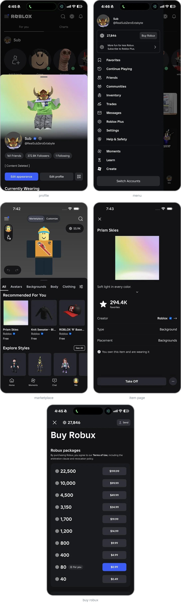

# roblox-larp

roblox look-alike for iphone. fake profile, robux, avatar, marketplace, the lot. just for fun, not affiliated with roblox.

## build

swiftui, built unsigned on github actions, installed with sideloadly.

```
cd Packages/BloxKit && swift test
```

`server/` is the small avatar service the app talks to.

## the app

<picture>
  <source media="(min-width: 768px)" srcset="shots/app-wide.webp">
  
</picture>

## the editor

<picture>
  <source media="(min-width: 768px)" srcset="shots/editor-wide.webp">
  
</picture>
