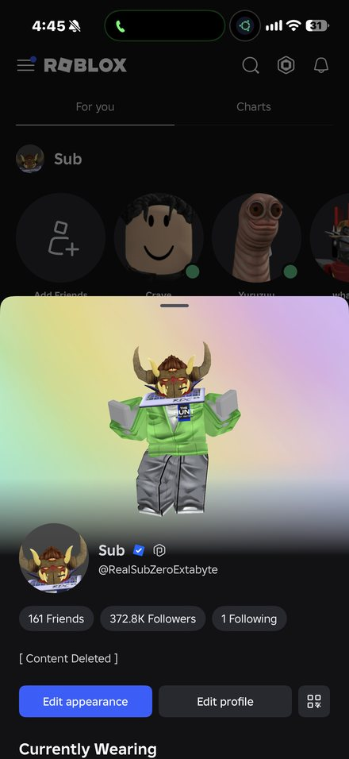
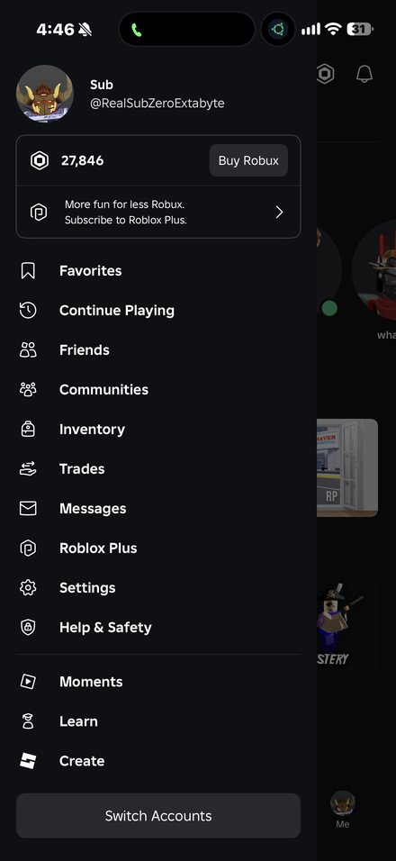
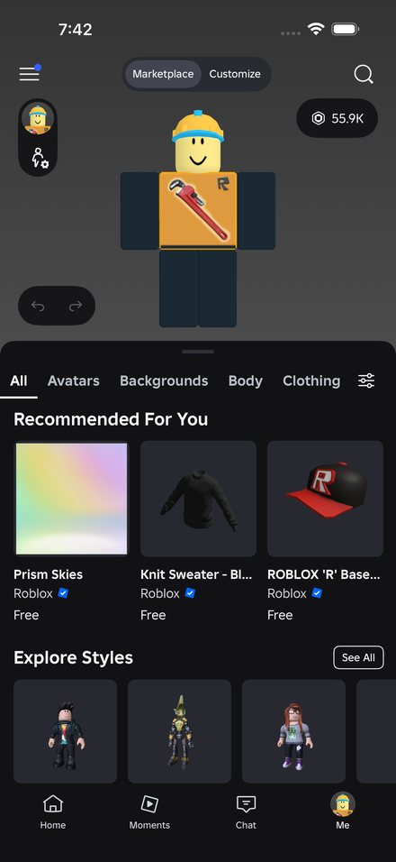
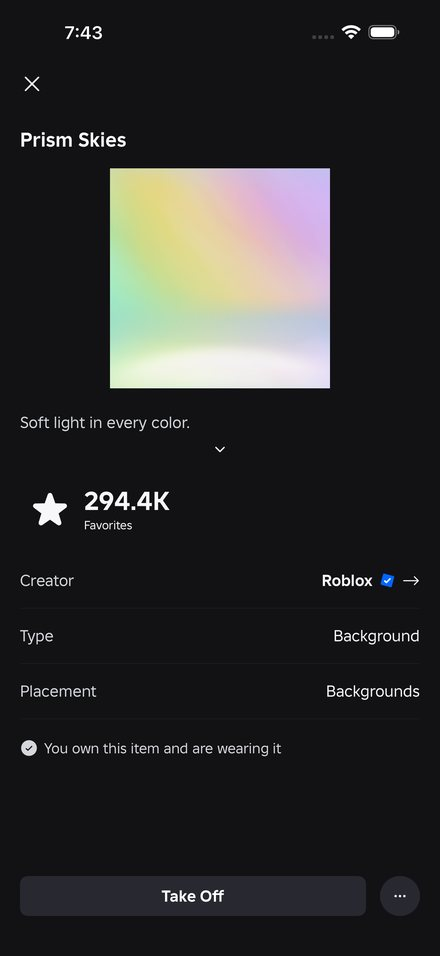
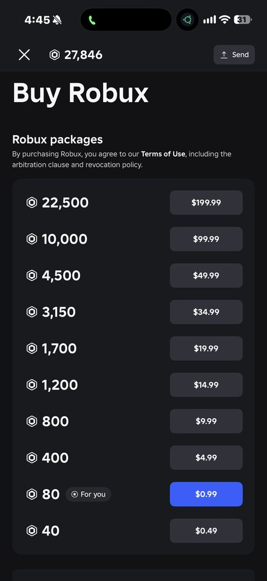
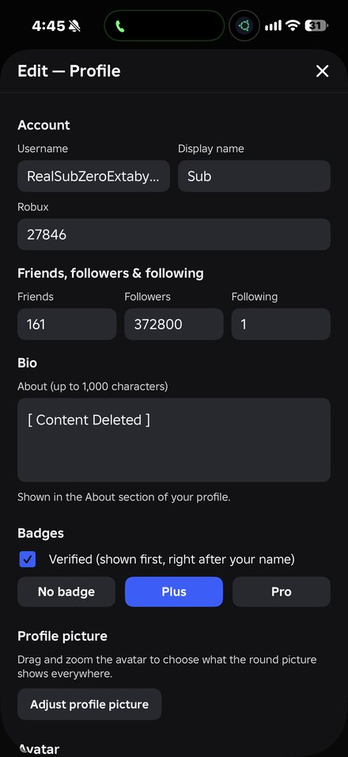
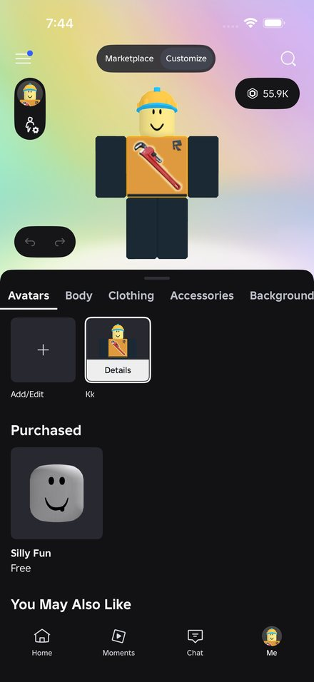
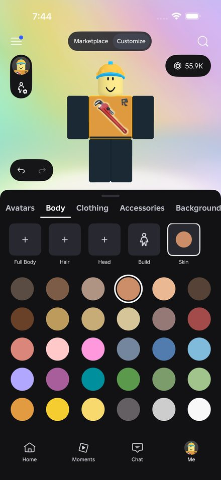
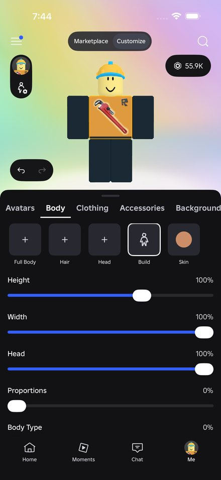

# roblox-larp

roblox look-alike for iphone. fake profile, robux, avatar, marketplace, the lot. just for fun, not affiliated with roblox.

## the app

|  |  |  |  |  |
|:-:|:-:|:-:|:-:|:-:|
| profile | menu | marketplace | item page | buy robux |

## the editor

everything on the profile is yours to set.

|  |  |  |  |
|:-:|:-:|:-:|:-:|
| edit profile | saved outfits | skin | build |

## build

swiftui, built unsigned on github actions, installed with sideloadly.

```
cd Packages/BloxKit && swift test
```

`server/` is the small avatar service the app talks to.
