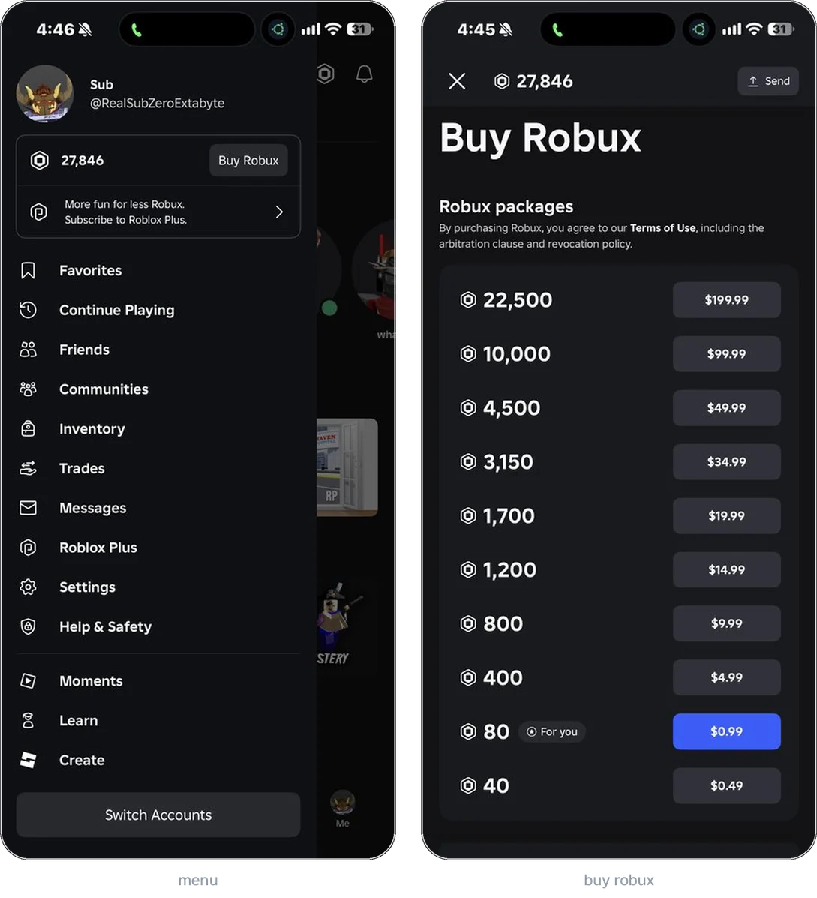
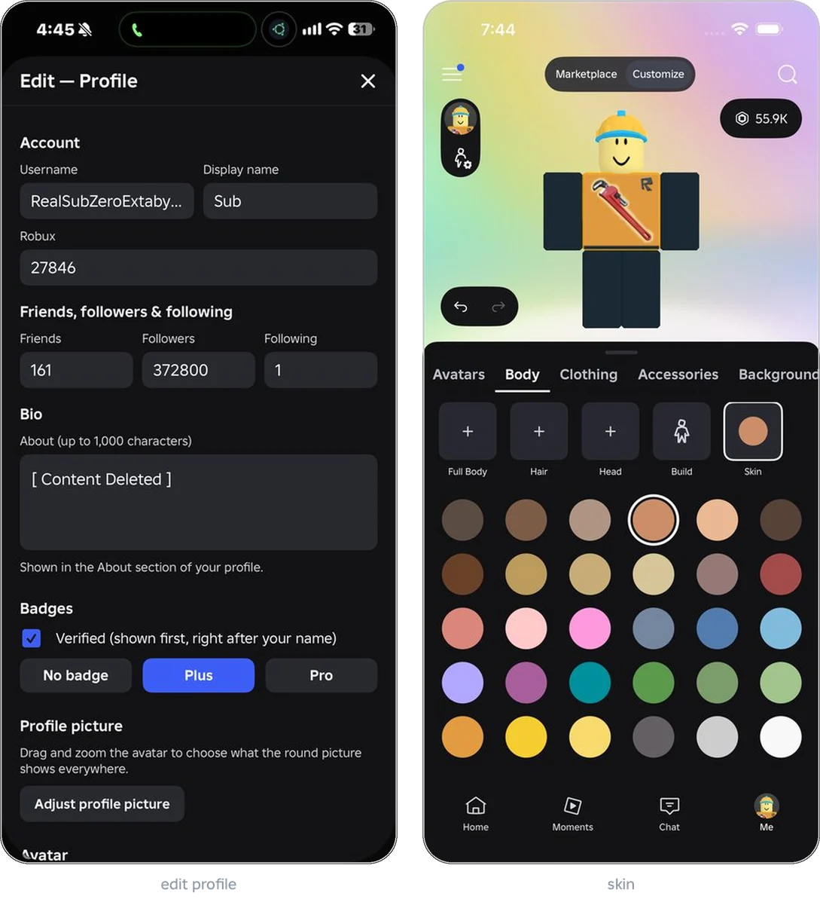

# roblox-larp

Roblox fan app for iPhone with a profile, Robux, avatar editor and marketplace. Built with SwiftUI.

```
cd Packages/SalBloxKit && swift test
```

Built unsigned on GitHub Actions and installed with Sideloadly. `server/` is the avatar service.

<picture>
  <source media="(min-width: 768px)" srcset="shots/main-row.webp">
  
</picture>

<picture>
  <source media="(min-width: 768px)" srcset="shots/edit-row.webp">
  
</picture>

Not affiliated with Roblox. The Roblox name, logo and assets belong to Roblox Corporation. If you represent Roblox and want something removed, open an issue.
